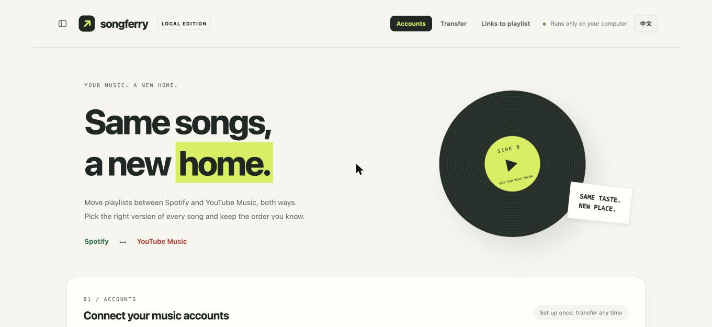
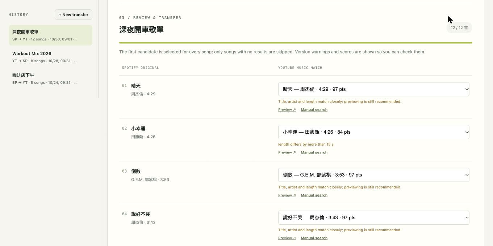
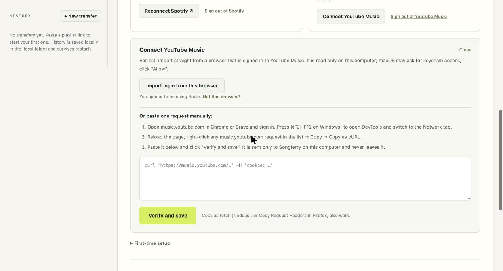
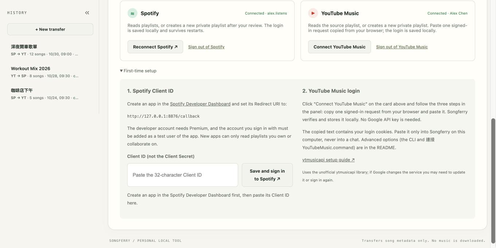

# Songferry

**English** · [繁體中文](README.zh-TW.md)

Songferry is a local tool that moves playlists between **Spotify** and **YouTube Music**, in both directions. It matches every song, lets you review and change each match, then creates a new private playlist and reads it back to verify. Only song metadata is transferred; no music is downloaded. The interface is available in English and Traditional Chinese.

> Currently supports Spotify ⟷ YouTube Music only. Other services are not supported yet.



## Why another playlist tool?

Plenty of tools copy playlists. Songferry is different in how it does it:

- **Review before writing.** Up to five candidates per song, with a heuristic score, version warnings (live, remix, cover…), preview links, manual search and skip. Nothing is created until you confirm.
- **Verified results.** After creating the playlist it reads the playlist back and compares song IDs and order. An accepted API request is not treated as success.
- **Never duplicates.** If a write fails or the result is unclear, the job is locked and nothing is resent automatically.
- **Runs only on your machine.** Bound to 127.0.0.1, no third-party service sees your playlists, and the Spotify login plus every transfer are stored under `.local/` so they survive restarts.
- **History sidebar.** Every transfer is kept locally; reopen one any time to keep editing or to check what was created.



## Requirements

- Python 3.10 or newer (3.12 recommended)
- A Spotify account with a developer app (free; Premium is required by Spotify for new developer apps)
- A YouTube Music account signed in through a Chromium browser (for copying the login headers)

## Run

```sh
git clone https://github.com/SamLiaoP/Songferry.git
cd Songferry
python3 -m venv .venv
.venv/bin/python -m pip install -r requirements.txt
.venv/bin/python app.py
```

Open http://127.0.0.1:8876. On macOS you can double-click `啟動.command` instead; it creates `.venv` and installs the dependencies on the first run only. Press Control-C in the terminal to stop. Use the **EN / 中文** button in the header to switch languages.

## First-time setup

### Spotify

1. Go to https://developer.spotify.com/dashboard, create an app and enable the Web API.
2. Set the Redirect URI to exactly **`http://127.0.0.1:8876/callback`**.
3. Add the Spotify account you will sign in with to the app's user list.
4. Paste the **Client ID** into Songferry's first-time setup and click *Save and sign in to Spotify*. No Client Secret is needed; the login uses PKCE.

Spotify's 2026 development-mode apps require the developer to have Premium, allow at most 5 users, and can only read playlists you own or collaborate on. Songferry does not try to work around these limits. Spotify → YouTube Music only asks for read scopes; YouTube Music → Spotify additionally asks for `playlist-modify-private`, so switching to that direction requires re-authorising once.

The Spotify token is saved to `.local/spotify_token.json` (mode 0600) and refreshed automatically. *Sign out of Spotify* in the Spotify card, or changing the Client ID, deletes it.

### YouTube Music

Songferry uses the open-source, unofficial [ytmusicapi](https://github.com/sigma67/ytmusicapi) library, which searches the YouTube Music catalogue directly. If Google changes the service this integration can break.

No Google API key is needed. Click **Connect YouTube Music** on the YouTube Music card. The panel offers two ways:

**Import from your browser (easiest).** Songferry detects Brave, Chrome, Edge, Chromium and Firefox profiles on this computer. Click *Import login from this browser*: Songferry works out which browser the page is open in and reads the YouTube cookies straight from that browser's cookie store, the same way `yt-dlp --cookies-from-browser` does. On macOS the system asks once whether to allow access to the browser's keychain entry; click **Allow**. Nothing leaves your machine. On Windows, Chrome 127 and later encrypt cookies in a way this cannot read; use Firefox or the manual method there.

**Or paste one request manually:**

1. Open https://music.youtube.com in Chrome or Brave and sign in. Press ⌘⌥I (F12 on Windows) to open DevTools and switch to the **Network** tab.
2. Reload the page, right-click any `music.youtube.com` request in the list → Copy → **Copy as cURL**. *Copy as fetch (Node.js)* and Firefox's *Copy Request Headers* also work; plain *Copy as fetch* does not include the cookie.
3. Paste it into the panel and click **Verify and save**. Songferry parses it locally (the copied command is never executed), keeps only the login headers, verifies them with a read-only account query, and saves them to `.local/browser.json`. The card then shows the connected account name. *Sign out of YouTube Music* deletes the saved login.



The copied text contains your login cookies. Paste it only into Songferry on this computer; never into a chat or an issue. Two alternatives exist for scripts or other systems: double-click `連接YouTubeMusic.command` on macOS to import the clipboard (it clears the clipboard afterwards), or use the ytmusicapi CLI:

```sh
mkdir -p .local && chmod 700 .local
.venv/bin/ytmusicapi browser --file .local/browser.json
chmod 600 .local/browser.json
```

Everything under `.local/` (`browser.json`, `spotify_token.json`, `config.json`, `jobs/`) holds credentials or your playlist data. It is git-ignored; never share it, sync it to the cloud, or commit it. Deleting the folder removes all saved logins and history.



## Transfer a playlist

1. Choose the **direction**, paste a full `https://open.spotify.com/playlist/…` or `https://music.youtube.com/playlist?list=…` link, and click *Load and match*. The reverse direction needs Spotify connected first.
2. Wait for the song-by-song search. Long playlists take a few minutes.
3. Review each song. The first candidate is selected by default; you can preview, pick another version, search manually or skip. **The score is a text-and-length heuristic, not a probability.**
4. Enter a name and click *Confirm and create*. Order and duplicates are preserved.
5. Songferry reads the new playlist back and checks IDs and order. If verification fails it tells you clearly to check the destination service. Spotify writes happen in batches of 100; if a batch fails, the playlist link is kept, the job is marked unconfirmed, and nothing is resent.

Podcasts, local files and unreadable items are skipped. Regional availability, licensing and song versions can all affect matches; preview the songs that matter to you.

## History

Every transfer is saved as `.local/jobs/<id>.json` the moment it starts and updated while matching, when you change a selection or playlist name, and after creation. The sidebar lists them newest first; click one to reopen it. Interrupted jobs (server stopped mid-match) are marked and must be reloaded. Deleting an entry removes only the local record, never a created playlist.

## Errors and limits

- Spotify 403: check Premium, the app's test users, and that the source playlist is yours or collaborative.
- Spotify 429: wait for the Retry-After shown and try again; Songferry never retries in bulk.
- YouTube Music search failures: use *Manual search*; if it keeps failing check your network or ytmusicapi compatibility.
- Unknown create result: a network drop may still have created the playlist. Check the destination before trying again. The same job will not send a second create request.
- One matching job runs at a time. Keep the page open while creating.
- This is a single-user local tool: no multi-user mode, scheduled sync or cloud deployment.

## Development and tests

```sh
.venv/bin/python -m unittest -v test_app.py test_connect_youtube.py test_reverse.py test_persistence.py test_i18n.py
```

The tests run offline against mocked services and never touch your real `.local/`. See [DEVELOPMENT.md](DEVELOPMENT.md) for the architecture, HTTP API and storage layout, and [CONTRIBUTING.md](CONTRIBUTING.md) before opening a pull request.

## License

[MIT](LICENSE). Dependencies keep their own licenses.

## Security notes

Songferry binds to 127.0.0.1 only, checks the Host header, requires a per-session CSRF token on every state-changing request, serves a strict Content-Security-Policy, and never uses `innerHTML`. Credentials are stored with mode 0600 inside a 0700 directory and are never printed or logged. Spotify's token is stored in plain JSON on disk; keep the project folder private.
