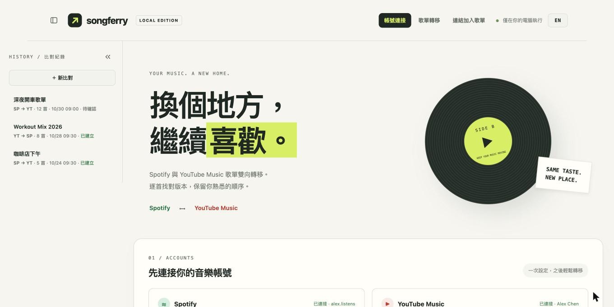
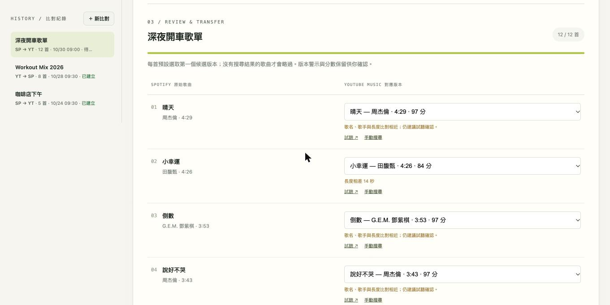
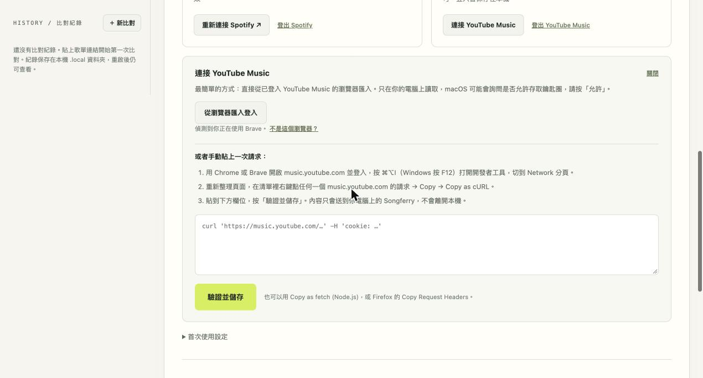

# Songferry

[English](README.md) · **繁體中文**

Songferry 是一個在你電腦上執行的本機工具，可以把歌單在 **Spotify** 與 **YouTube Music** 之間雙向轉移。它會逐首比對、讓你確認與調整每一首的對應版本，再建立新的私人歌單並讀回核對。只轉移歌曲資訊，不下載音樂。介面提供繁體中文與英文。

> 目前只支援 Spotify ⟷ YouTube Music 互轉，尚不支援其他平台。



## 為什麼還要再做一個歌單轉移工具？

轉移歌單的工具不少，Songferry 的差別在做法：

- **先確認再寫入。** 每首最多列出 5 個候選版本，附啟發式分數、版本警示（現場、混音、翻唱⋯）、試聽連結、手動搜尋與略過。你按下確認之前不會建立任何東西。
- **建立後核對。** 建立歌單後會讀回目標歌單，逐一比對歌曲 ID 與順序；API 回覆「成功」不算成功。
- **絕不重複加歌。** 寫入失敗或結果不明時，該工作會被鎖住，不會自動重送。
- **只在你的電腦上跑。** 只監聽 127.0.0.1，沒有第三方服務看得到你的歌單；Spotify 登入與每一次比對都存在 `.local/`，重啟後還在。
- **左側比對紀錄。** 每次轉移都保存在本機，隨時點回去繼續調整或查看建立結果。



## 需求

- Python 3.10 以上，建議 3.12
- 一個 Spotify 帳號與開發者 App（免費；Spotify 要求新 App 的開發者需有 Premium）
- 一個在 Chromium 系瀏覽器登入的 YouTube Music 帳號（用來複製登入標頭）

## 啟動

```sh
git clone https://github.com/SamLiaoP/Songferry.git
cd Songferry
python3 -m venv .venv
.venv/bin/python -m pip install -r requirements.txt
.venv/bin/python app.py
```

打開 http://127.0.0.1:8876 。macOS 也可以直接雙擊 `啟動.command`，它只在第一次建立 `.venv` 並安裝套件，之後啟動不會再連 PyPI；要更新套件時手動執行 `.venv/bin/python -m pip install -r requirements.txt`。停止時在終端機按 Control-C。頁首的 **EN / 中文** 按鈕可切換語言。

## 首次設定

### Spotify

1. 前往 https://developer.spotify.com/dashboard 建立 App，啟用 Web API。
2. Redirect URI 設定成 **`http://127.0.0.1:8876/callback`**，必須完全一致。
3. 在 App 的使用者管理中加入要登入的 Spotify 帳號。
4. 複製 **Client ID** 到工具的「首次使用設定」，按「儲存並登入 Spotify」。不需要 Client Secret，登入使用 PKCE。

2026 年的新開發模式 App 要求開發者有 Premium，最多 5 位授權使用者，而且只能讀取自己擁有或共同編輯的歌單。Songferry 不會嘗試繞過這些限制。Spotify → YouTube Music 僅要求讀取權限；YouTube Music → Spotify 另外要求 `playlist-modify-private`，切到反向時需重新授權一次。

Spotify token 保存在 `.local/spotify_token.json`（權限 0600），過期時自動更新。按 Spotify 卡片的「登出 Spotify」或更換 Client ID 會刪除它。

### YouTube Music

Songferry 使用非 Google 官方的開源 [ytmusicapi](https://github.com/sigma67/ytmusicapi)，直接搜尋 YouTube Music 的歌曲目錄。Google 變更服務時，這個整合可能失效。

不需要 Google API 金鑰。按 YouTube Music 卡片的「**連接 YouTube Music**」，面板提供兩種方式：

**從瀏覽器匯入（最簡單）。** Songferry 會偵測這台電腦上的 Brave、Chrome、Edge、Chromium 與 Firefox 設定檔。按「從瀏覽器匯入登入」，Songferry 會判斷頁面目前開在哪個瀏覽器，直接從它的 Cookie 資料庫讀取 YouTube 的 Cookie，做法和 `yt-dlp --cookies-from-browser` 相同。macOS 會問一次是否允許存取該瀏覽器的鑰匙圈項目，按「**允許**」即可。整個過程不會把任何資料送出你的電腦。Windows 上 Chrome 127 以後的 Cookie 加密方式無法這樣讀取，請改用 Firefox 或手動方式。

**或者手動貼上一次請求：**

1. 用 Chrome 或 Brave 開啟 https://music.youtube.com 並登入。按 ⌘⌥I（Windows 按 F12）打開開發者工具，切到 **Network** 分頁。
2. 重新整理頁面，在清單裡右鍵點任何一個 `music.youtube.com` 的請求 → Copy → **Copy as cURL**。「Copy as fetch (Node.js)」和 Firefox 的「Copy Request Headers」也可以；一般的「Copy as fetch」不含 Cookie。
3. 貼到面板的欄位，按「**驗證並儲存**」。Songferry 在本機解析（不會執行複製的指令）、只保留登入相關標頭、用唯讀的帳號查詢驗證，然後存到 `.local/browser.json`。卡片會顯示已連接的帳號名稱；「登出 YouTube Music」會刪除保存的登入。



複製的內容含有你的登入 Cookie，只能貼進這台電腦上的 Songferry，請勿貼到聊天或 issue。腳本或其他系統有兩個替代方式：macOS 雙擊 `連接YouTubeMusic.command` 匯入剪貼簿（完成後會清空剪貼簿），或用 ytmusicapi 的終端機指令：

```sh
mkdir -p .local && chmod 700 .local
.venv/bin/ytmusicapi browser --file .local/browser.json
chmod 600 .local/browser.json
```

`.local/` 裡的所有檔案（`browser.json`、`spotify_token.json`、`config.json`、`jobs/`）都含有登入資訊或你的歌單內容，已列在 `.gitignore`，請勿分享、雲端同步或提交。刪除整個資料夾就會移除所有保存的登入與紀錄。

## 轉移歌單

1. 選擇**轉換方向**，貼上完整的 `https://open.spotify.com/playlist/…` 或 `https://music.youtube.com/playlist?list=…` 連結，按「讀取並比對」。反向需要先連接 Spotify。
2. 等待逐首搜尋。長歌單可能花幾分鐘。
3. 逐首確認。預設選取第一個候選版本，可以試聽、換選、手動搜尋或略過。**分數是文字與長度的啟發式評分，不代表正確率。**
4. 輸入歌單名稱，按「確認並建立」。保留原始順序與重複歌曲。
5. Songferry 會讀回新歌單，核對歌曲 ID 與順序。核對失敗會明確提示你到目標平台檢查。Spotify 每批寫入 100 首；若中途失敗，會保留歌單連結、標記結果未確認，不會自動重送。

Podcast、本機音檔與無法讀取的項目會略過。地區、版權與歌曲版本都可能影響比對結果，重要的歌建議先試聽。

## 比對紀錄

每次轉移在開始的那一刻就寫入 `.local/jobs/<id>.json`，比對中、改選版本或歌單名稱、建立之後都會更新。左側列表由新到舊，點一下就能重新打開。伺服器在比對中被關閉的工作會標記為「已中斷」，需重新讀取。刪除紀錄只刪本機資料，不會動已建立的歌單。

## 錯誤與限制

- Spotify 403：確認 Premium、App 測試使用者，以及來源歌單是否為自己擁有或共同編輯。
- Spotify 429：等待畫面顯示的 Retry-After 秒數再試；不會自動大量重送。
- YouTube Music 搜尋失敗：用「手動搜尋」重試；持續失敗請檢查網路或 ytmusicapi 相容性。
- 建立結果不明：網路中斷也可能已建立成功，請先到目標平台檢查。同一工作不會再送第二次建立要求。
- 同時只能跑一個比對。建立時請保持頁面開啟。
- 這是單人本機工具，沒有多使用者、排程同步或雲端部署。

## 開發與測試

```sh
.venv/bin/python -m unittest -v test_app.py test_connect_youtube.py test_reverse.py test_persistence.py test_i18n.py
```

測試以模擬服務離線執行，不會碰到你真實的 `.local/`。架構、HTTP API 與儲存方式見 [DEVELOPMENT.md](DEVELOPMENT.md)，送 PR 前請看 [CONTRIBUTING.md](CONTRIBUTING.md)。

## 授權

[MIT](LICENSE)。依賴套件保留其各自的授權。

## 安全說明

Songferry 只綁定 127.0.0.1、檢查 Host 標頭、所有會改變狀態的請求都要求本次啟動專屬的 CSRF token、使用嚴格的 Content-Security-Policy，前端不使用 `innerHTML`。登入資料以 0600 權限存在 0700 的資料夾內，不會被印出或寫入 log。Spotify token 以明文 JSON 存在磁碟上，請保持專案資料夾私密。
